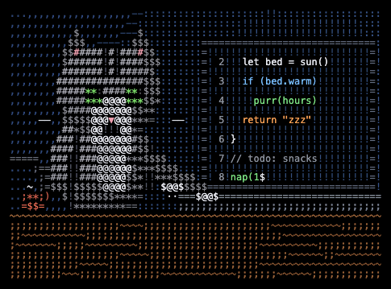

<p align="center">
  
</p>

#### 👩🏻‍💻 MJ Lee

\
Python&nbsp;&nbsp;·&nbsp;&nbsp;SQL&nbsp;&nbsp;·&nbsp;&nbsp;APIs\
\
✨ curious, organized, always tweaking

### About Me

```yaml
name: Myungji Lee
located_in: Seoul, South Korea

fields_of_interest:
  [
    "Backend Development",
    "Frontend Development",
    "AI Engineering",
    "Data Analysis"
  ]

currently_learning:
  [
    "FastAPI",
    "React & Next.js",
    "Supabase",
    "Cloud & Deployment"
  ]

current_focus: "Turning what I learn into working projects"
```

### Tech Stack I Work With

<p>
  
  
  
  
  
  
  
  
</p>

### Connect with Me

[](https://github.com/mjlee0914)
[](https://mjlee0914.github.io/)

<sub>Cat at the Keyboard ASCII art by <a href="https://www.ascii-magic.com/ascii/laptop-typing-cat">ASCII Magic</a> (MIT).</sub>
